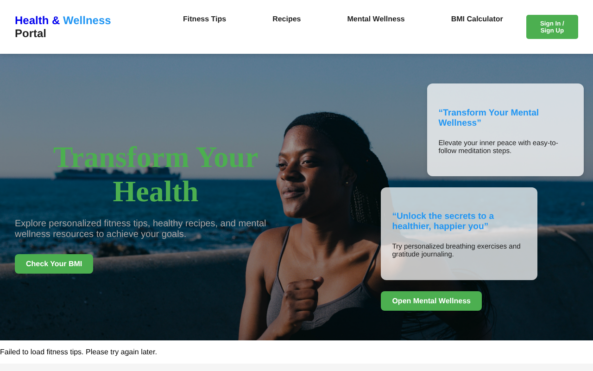
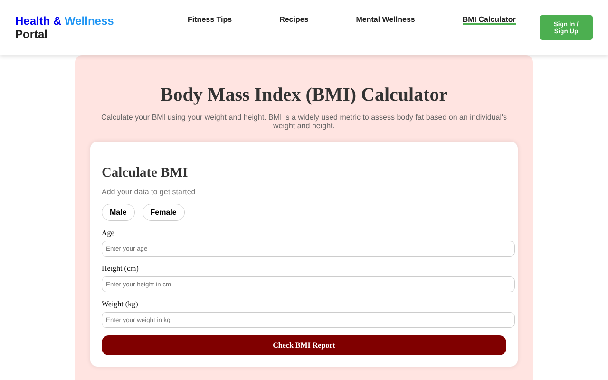

# Health & Wellness Portal

A team project from college. I built the React frontend, which brings together fitness tips, healthy recipes, mental wellness content and a BMI calculator in one place.

🔗 **Live demo:** https://huanhou.github.io/health-wellness-portal/



## What's inside
- **Fitness tips** and **recipes**, each with its own detail page and recipe categories
- **Mental wellness** section with meditation and relaxing sounds
- **BMI calculator**
- **Sign-in / sign-up** modal
- Scroll animations

Fitness tips, recipes and user accounts came from a REST API built by my teammate and hosted on Azure. That server is no longer running, so those sections don't load in the live demo. The BMI calculator and mental wellness pages work fully.



## Built with
React · React Router · Axios · React Icons · AOS · deployed on GitHub Pages

## Run it locally
```bash
npm install
npm start
```

To publish a new version to GitHub Pages: `npm run deploy`
